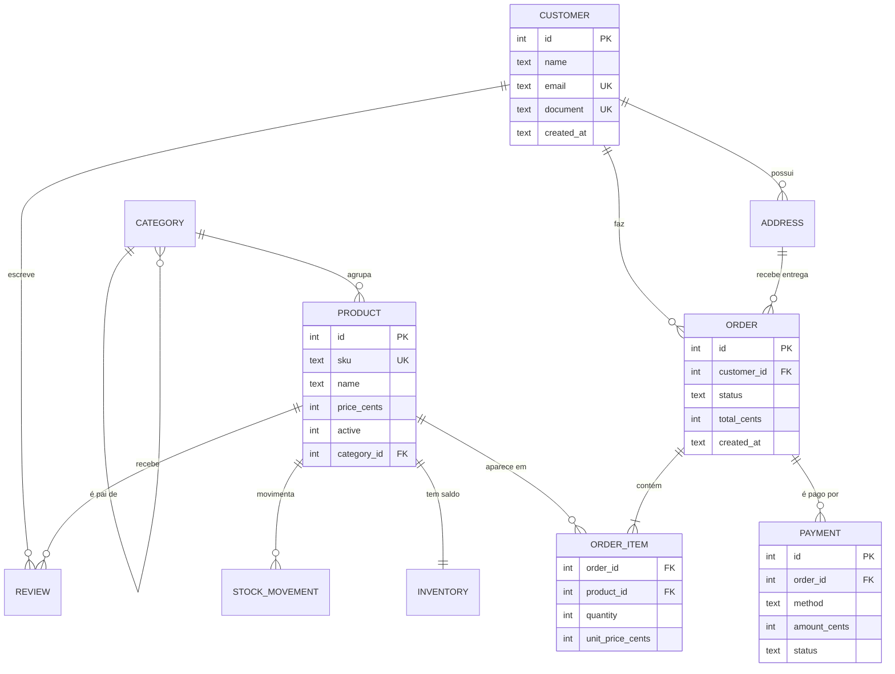
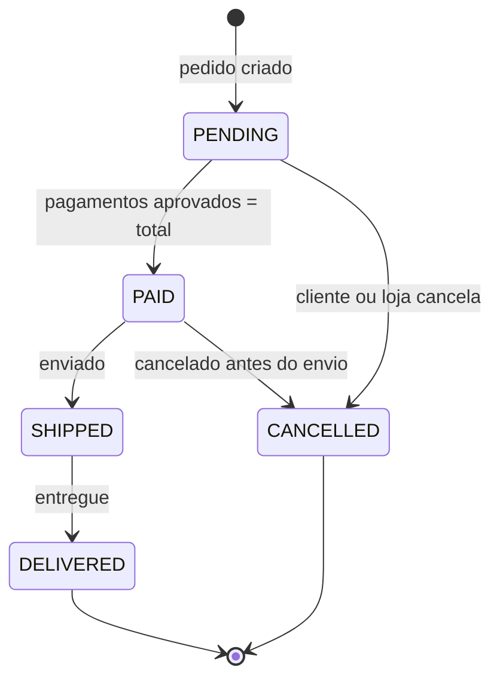

<div align="center">


# ☿ Mercurium
### O cofre de dados do deus do comércio

**Laboratório de modelagem e SQL avançado com SQLite, no domínio de um e-commerce.**
Do requisito ao índice: modelo conceitual, normalização, schema físico, consultas analíticas,<br/>
triggers, performance medida com `EXPLAIN QUERY PLAN` e testes de integridade no CI.


</div>

---

## 👨‍💻 Autor

<table>
  <tr>
    <td width="62%">

**Mercurium** é o primeiro projeto do meu portfólio público de Desenvolvedor Pleno, idealizado e mantido por **Gustavo Osterno Thé**.

O projeto é construído **um dia de cada vez**, com roadmap público, commits pequenos e decisões registradas em ADRs. A ideia é mostrar não só o resultado final, mas o **processo**: como um banco de dados nasce dos requisitos de negócio e evolui até estar pronto para produção.

    </td>
    <td width="38%">

| | |
|---|---|
| 🌐 Site | [site-gustavothe-dev.web.app](https://site-gustavothe-dev.web.app/) |
| 💼 LinkedIn | [gustavoosterno](https://www.linkedin.com/in/gustavoosterno/) |
| 🐙 GitHub | [@GustavoThe01](https://github.com/GustavoThe01) |
| 📸 Instagram | [@gustavo.osterno](https://www.instagram.com/gustavo.osterno) |

    </td>
  </tr>
</table>

---

## 📑 Sumário

- [Em números](#-em-números)
- [A origem do nome](#-a-origem-do-nome)
- [O que o projeto resolve](#-o-que-o-projeto-resolve)
- [Modelo de dados](#️-modelo-de-dados)
- [Regras de negócio](#-regras-de-negócio)
- [Perguntas que o banco responde](#-perguntas-que-o-banco-responde)
- [Competências demonstradas](#-competências-demonstradas)
- [Metodologias e decisões](#-metodologias-e-decisões)
- [Roadmap](#️-roadmap)
- [Como rodar](#-como-rodar)
- [Estrutura do projeto](#-estrutura-do-projeto)
- [O que ainda falta](#-o-que-ainda-falta)
- [Projetos relacionados](#-projetos-relacionados)

---

## 📊 Em números

<div align="center">

| 🗃️ Modelo | 🧠 SQL | 🧪 Qualidade | 🗓️ Processo |
|:---:|:---:|:---:|:---:|
| **10** entidades planejadas | **15** consultas fundamentais | testes de integridade no CI | **10** dias de roadmap |
| **8** regras de negócio | **CTEs** recursivas e **window functions** | `EXPLAIN` antes/depois | **1** ADR registrado |
| até a **3FN** | **views** e **triggers** | migrações versionadas | Conventional Commits |

</div>

---

## ☿ A origem do nome

> *Mercúrio, mensageiro dos deuses romanos, protegia os comerciantes, os viajantes e o lucro honesto.*

O nome vem de **Mercurius**, deus do comércio — a mesma raiz de *mercado* e *mercadoria*. O Mercurium é o "cofre" onde ficam guardados os clientes, produtos, pedidos e pagamentos de uma loja virtual fictícia. Cada pedido é uma mensagem entre quem vende e quem compra, e o banco é quem garante que nenhuma delas se perca.

---

## ✨ O que o projeto resolve

Uma loja virtual vende produtos organizados em **categorias hierárquicas**. Clientes fazem **pedidos**, pagam com **um ou mais meios de pagamento** e podem **avaliar** o que compraram. O **estoque** é controlado por produto e toda movimentação precisa ser rastreável.

O laboratório responde a uma pergunta simples: *como modelar isso de um jeito que o próprio banco proteja os dados e responda rápido às perguntas do negócio?*

| Camada | O que entrega |
|---|---|
| 📐 **Modelagem** | Requisitos, DER, normalização até a 3FN e decisões documentadas |
| 🏗️ **Schema** | Tabelas `STRICT`, chaves, `CHECK`, `UNIQUE`, `ON DELETE` justificados |
| 🌱 **Dados** | Seeds realistas (centenas de pedidos) carregados em transação |
| 🔎 **Consultas** | Do `JOIN` básico a CTEs recursivas e window functions |
| ⚙️ **Automação no banco** | Views analíticas, triggers de estoque e auditoria |
| 🚀 **Performance** | Índices compostos, parciais e de cobertura, medidos com `EXPLAIN QUERY PLAN` |
| 🔍 **Recursos do SQLite** | Busca textual com **FTS5** e atributos em **JSON** |
| ✅ **Qualidade** | Migrações versionadas, script de build e testes de integridade no CI |

---

## 🗄️ Modelo de dados

> Versão inicial, derivada dos requisitos em [`docs/modelagem.md`](docs/modelagem.md). O DER definitivo chega no Dia 02.



### Ciclo de vida de um pedido



> 💡 **Por que valores em centavos?** O SQLite não tem `DECIMAL` nativo. Guardar dinheiro em `REAL` gera erros de arredondamento; guardar em **centavos (`INTEGER`)** é exato. A decisão está no [ADR 0001](docs/adr/0001-usar-sqlite.md).

---

## 📏 Regras de negócio

| # | Regra | Como o banco garante |
|:---:|---|---|
| 1 | E-mail e documento do cliente são únicos | `UNIQUE` |
| 2 | Preço > 0 e estoque nunca negativo | `CHECK` + trigger com `RAISE(ABORT)` |
| 3 | Preço do item é **copiado** no momento da compra | coluna `unit_price_cents` em `order_item` |
| 4 | Status segue o ciclo `PENDING → PAID → SHIPPED → DELIVERED` | `CHECK` + trigger de transição |
| 5 | Pedido só vira `PAID` quando os pagamentos fecham o total | trigger / view de conferência |
| 6 | Cliente só avalia o que comprou e recebeu, uma vez | `UNIQUE (customer_id, product_id)` + trigger |
| 7 | Toda alteração de estoque gera movimentação | trigger em `inventory` |
| 8 | Produto vendido é desativado, nunca excluído | `ON DELETE RESTRICT` |

---

## ❓ Perguntas que o banco responde

- 🏆 Quais os **10 produtos mais vendidos** do mês, por categoria? *(window function `RANK`)*
- 💰 Qual o **ticket médio** e o **lifetime value** de cada cliente?
- 📦 Quais produtos estão **abaixo do estoque mínimo**?
- 📈 Qual a **evolução mensal do faturamento** e o crescimento sobre o mês anterior? *(`LAG`)*
- 💤 Quais clientes **não compram há mais de 90 dias**?
- 🌳 Qual o faturamento de uma categoria **somando todas as subcategorias**? *(CTE recursiva)*

---

## 🧠 Competências demonstradas

| Área | Conceitos |
|---|---|
| **Modelagem** | Modelo conceitual → lógico → físico, cardinalidades, chaves naturais vs. surrogate |
| **Normalização** | 1FN, 2FN, 3FN e quando desnormalizar conscientemente |
| **Integridade** | `PRIMARY KEY`, `FOREIGN KEY`, `UNIQUE`, `CHECK`, `NOT NULL`, tabelas `STRICT` |
| **Consultas** | `JOIN`s, agregações, `HAVING`, subconsultas correlacionadas, `EXISTS` |
| **SQL analítico** | CTEs (inclusive recursivas), `ROW_NUMBER`, `RANK`, `LAG/LEAD`, totais acumulados |
| **Automação** | Views, triggers de auditoria e de estoque, transações ACID |
| **Performance** | Índices compostos, parciais e de cobertura; leitura de planos de execução |
| **SQLite moderno** | FTS5, funções JSON (`json_extract`, `json_each`) |
| **Engenharia** | Migrações versionadas, scripts de build, testes de integridade, CI |

---

## 🧭 Metodologias e decisões

- **Roadmap diário público** — cada dia vira uma issue, uma branch e um PR. Veja o [ROADMAP.md](ROADMAP.md).
- **Conventional Commits** — histórico legível (`feat:`, `docs:`, `test:`...).
- **ADR (Architecture Decision Records)** — toda decisão relevante fica registrada com contexto e alternativas.
- **Banco como guardião** — regras críticas ficam em constraints e triggers, não só na aplicação.
- **Medir antes de otimizar** — nenhum índice entra sem `EXPLAIN QUERY PLAN` antes e depois.

| ADR | Decisão | Status |
|---|---|---|
| [0001](docs/adr/0001-usar-sqlite.md) | Usar SQLite, com tabelas `STRICT` e dinheiro em centavos | ✅ Aceita |

---

## 🗺️ Roadmap

| Semana | Dias | Tema | Progresso |
|---|---|---|---|
| 1 | 01–05 | Requisitos, DER, normalização, DDL, seeds e consultas fundamentais | 🟩⬜⬜⬜⬜ |
| 2 | 06–10 | CTEs, window functions, views, triggers, performance, FTS5, CI e release | ⬜⬜⬜⬜⬜ |

Detalhes de cada dia no [ROADMAP.md](ROADMAP.md) e histórico de mudanças no [CHANGELOG.md](CHANGELOG.md).

---

## 🚀 Como rodar

> O script de build automático chega no **Dia 09**. Até lá, o fluxo é manual.

**Pré-requisito:** [SQLite 3](https://sqlite.org/download.html) (ou o [DB Browser for SQLite](https://sqlitebrowser.org/)).

```bash
winget install SQLite.SQLite
```

```bash
git clone https://github.com/GustavoThe01/mercurium-sql.git
```

```bash
cd mercurium-sql
```

A partir do Dia 03, para criar o banco:

```bash
sqlite3 mercurium.db < migrations/V001__create_schema.sql
```

---

## 📁 Estrutura do projeto

```
mercurium-sql/
├── docs/
│   ├── adr/                 # ✅ decisões de arquitetura
│   ├── assets/              # ✅ banner e imagens
│   ├── modelagem.md         # ✅ requisitos e regras de negócio
│   ├── der.md               # ⏳ Dia 02 — diagrama entidade-relacionamento
│   └── performance.md       # ⏳ Dia 08 — análises antes/depois de índices
├── migrations/              # ⏳ Dia 03 — V001__create_schema.sql, V002__...
├── seeds/                   # ⏳ Dia 04 — dados de exemplo
├── queries/                 # ⏳ Dias 05–06 — exercícios resolvidos por nível
├── tests/                   # ⏳ Dia 10 — asserts de integridade
├── scripts/                 # ⏳ Dia 09 — build.ps1 / build.sh
├── CHANGELOG.md
└── ROADMAP.md
```

---

## 🧩 O que ainda falta

Checklist vivo do que ainda precisa ser incrementado neste repositório (código e documentação).

**Projeto**
- [ ] DER definitivo em `docs/der.md` e normalização documentada (Dia 02)
- [ ] Schema físico `V001__create_schema.sql` (Dia 03)
- [ ] Seeds realistas (Dia 04)
- [ ] Consultas fundamentais e avançadas resolvidas (Dias 05–06)
- [ ] Views e triggers (Dia 07)
- [ ] Análise de performance com índices (Dia 08)
- [ ] FTS5, JSON e scripts de build (Dia 09)
- [ ] Testes de integridade e CI no GitHub Actions (Dia 10)

**README**
- [ ] Badge de CI (quando o workflow existir)
- [ ] Prints do banco no DB Browser e exemplos de resultado das consultas
- [ ] Tabela com os planos de execução antes/depois dos índices
- [ ] Atualizar "Em números" com valores reais (linhas de seed, consultas, testes)
- [ ] Definir e adicionar uma licença (`LICENSE`)
- [ ] Versão em inglês do README

---

## 🔗 Projetos relacionados

Este repositório faz parte de uma trilha de 5 projetos:

| Projeto | Stack | Relação |
|---|---|---|
| ☿ **Mercurium** | SQLite | *você está aqui* |
| ⚒ [Nidavellir](https://github.com/GustavoThe01/nidavellir-inventory) | Java 21 + JDBC | Estoque em Java puro, com SQL escrito à mão |
| ⚖ [Plutus](https://github.com/GustavoThe01/plutus-ledger) | C# + Dapper | Livro-razão bancário com transações explícitas |
| ♾ [Moirai](https://github.com/GustavoThe01/moirai-taskflow) | Spring Boot | API de tarefas com Arquitetura Hexagonal |
| ✦ [Bifrost](https://github.com/GustavoThe01/bifrost-orders) | ASP.NET Core | **Reaproveita este modelo de dados** na API de pedidos |

<div align="center">

<sub>Feito com ☕ e SQL por <a href="https://github.com/GustavoThe01">Gustavo Osterno Thé</a></sub>

</div>
