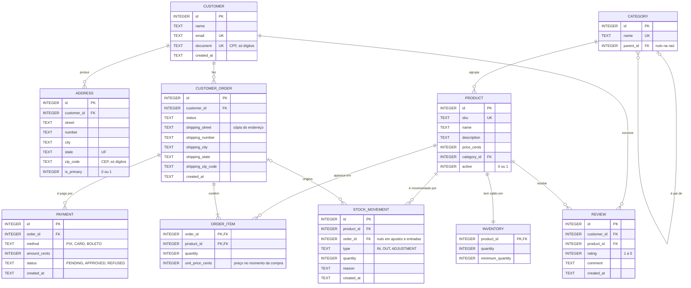

# DER — Mercurium

Aqui está o modelo entidade-relacionamento que desenhei a partir dos requisitos em [modelagem.md](modelagem.md).
O schema físico que implementa este modelo está em [`V001__create_schema.sql`](../migrations/V001__create_schema.sql).

## 1. Diagrama

## 2. Cardinalidades

| Relação | Cardinalidade | Por quê |
|---|---|---|
| Cliente → Endereço | 1 : N | Um cliente pode ter vários endereços; cada endereço pertence a um único cliente |
| Cliente → Pedido | 1 : N | O cliente pode ainda não ter comprado (0) ou ter muitos pedidos |
| Categoria → Categoria | 0..1 : N | Auto-relacionamento: a categoria raiz não tem pai |
| Categoria → Produto | 1 : N | Todo produto está em exatamente uma categoria |
| Produto → Estoque | 1 : 1 | Cada produto tem um único saldo; separei em outra tabela porque o saldo muda o tempo todo e o cadastro quase nunca |
| Pedido ↔ Produto | N : N | Resolvido pela tabela associativa `order_item` |
| Pedido → Pagamento | 1 : N | Um pedido pode ser pago em partes (ex.: PIX + cartão) ou ter tentativas recusadas |
| Produto → Movimentação | 1 : N | Histórico completo de entradas, saídas e ajustes |
| Cliente/Produto → Avaliação | 1 : N | Uma avaliação por cliente e produto, garantida por `UNIQUE (customer_id, product_id)` |

## 3. Decisões de modelagem

1. **`customer_order` em vez de `order`.** `ORDER` é palavra reservada do SQL (`ORDER BY`). Usar esse nome
   me obrigaria a escrever `"order"` entre aspas em toda consulta, o que é fonte de erro. Mantive o nome
   `order_item` porque ali não há conflito.
2. **Chaves surrogate (`INTEGER PRIMARY KEY`)** em todas as tabelas principais. Chaves naturais (e-mail, CPF, SKU)
   continuam únicas com `UNIQUE`, mas podem mudar; a chave técnica não muda nunca.
3. **Chave composta em `order_item`** (`order_id`, `product_id`): o mesmo produto não aparece duas vezes
   no mesmo pedido, a quantidade é que aumenta.
4. **Dinheiro em centavos (`INTEGER`)**, como decidi no [ADR 0001](adr/0001-usar-sqlite.md).
5. **Datas em `TEXT` no formato ISO 8601** (`2026-11-03T14:30:00Z`), o padrão recomendado pelo SQLite para
   usar as funções `date()`, `datetime()` e `strftime()`.
6. **O total do pedido não é coluna.** Ele é derivado de `SUM(quantity * unit_price_cents)`. Guardar o total
   criaria uma dependência transitiva (ver a 3FN abaixo) e o risco de o valor ficar diferente da soma dos itens.
   Se a consulta ficar lenta, uma view ou uma coluna mantida por trigger resolve, de forma consciente.
7. **`unit_price_cents` é cópia proposital.** Parece duplicação do preço do produto, mas não é: é o preço
   **histórico**, que não pode mudar quando o produto for reajustado.

## 4. Normalização, passo a passo

Para mostrar de onde o modelo veio, parti de uma planilha "ingênua" de pedidos, do jeito que muita loja
pequena controla as vendas.

### Antes: tudo numa linha só (não normalizado)

| pedido | data | cliente | email | produtos | categorias | total |
|---|---|---|---|---|---|---|
| 1001 | 2026-11-01 | Ana Lima | ana@mail.com | Caneca (2x R$ 30), Camiseta (1x R$ 80) | Cozinha, Vestuário | R$ 140 |
| 1002 | 2026-11-02 | Ana Lima | ana@mail.com | Caneca (1x R$ 32) | Cozinha | R$ 32 |

Problemas: a coluna `produtos` guarda vários valores numa célula só, o e-mail da Ana se repete em cada
pedido e o total pode facilmente divergir dos itens.

### 1FN — valores atômicos, sem grupos repetidos

Separei cada produto do pedido numa linha própria.

| pedido | data | cliente | email | produto | categoria | qtd | preço |
|---|---|---|---|---|---|---|---|
| 1001 | 2026-11-01 | Ana Lima | ana@mail.com | Caneca | Cozinha | 2 | 30 |
| 1001 | 2026-11-01 | Ana Lima | ana@mail.com | Camiseta | Vestuário | 1 | 80 |
| 1002 | 2026-11-02 | Ana Lima | ana@mail.com | Caneca | Cozinha | 1 | 32 |

A chave agora é composta: (`pedido`, `produto`).

### 2FN — nada depende só de parte da chave

`data`, `cliente` e `email` dependem só de `pedido`; `categoria` depende só de `produto`.
Separei em três tabelas:

- **pedido** (`pedido`, `data`, `cliente`, `email`)
- **produto** (`produto`, `categoria`)
- **item_pedido** (`pedido`, `produto`, `qtd`, `preço`) → depende da chave inteira

### 3FN — nada depende de outro atributo que não seja a chave

Em **pedido**, o `email` depende do `cliente`, e não do pedido (dependência transitiva
`pedido → cliente → email`). Movi os dados do cliente para uma tabela própria:

- **cliente** (`id`, `nome`, `email`)
- **pedido** (`id`, `cliente_id`, `data`)

Com o mesmo raciocínio, a categoria virou tabela própria e o `total` saiu do pedido (é calculado).
O resultado é exatamente o DER da seção 1.

### Onde aceitei desnormalizar (de propósito)

| Dado | Por que fica "duplicado" |
|---|---|
| `order_item.unit_price_cents` | É o preço histórico da compra, não uma cópia do preço atual |
| `customer_order.shipping_*` | No Dia 03 decidi copiar o endereço de entrega para o pedido (snapshot), em vez de apontar para `address`. Se o cliente editar ou apagar o endereço depois, o pedido continua mostrando para onde foi enviado |

## 5. O que acontece ao excluir (`ON DELETE`)

Escolhi `RESTRICT` para tudo que é histórico e `CASCADE` só para o que não faz sentido sem o registro principal.

| Chave estrangeira | Regra | Por quê |
|---|---|---|
| `address.customer_id` | `CASCADE` | Endereço não existe sem cliente, e os pedidos guardam cópia própria |
| `category.parent_id` | `RESTRICT` | Excluir a categoria pai deixaria as filhas soltas |
| `product.category_id` | `RESTRICT` | Todo produto precisa de categoria; mova os produtos antes |
| `inventory.product_id` | `CASCADE` | O saldo é parte do produto (relação 1:1) |
| `customer_order.customer_id` | `RESTRICT` | Cliente com pedido é histórico de venda e não pode sumir |
| `order_item.order_id` | `CASCADE` | Item é parte do pedido |
| `order_item.product_id` | `RESTRICT` | Produto vendido é desativado, nunca excluído (regra 8) |
| `payment.order_id` | `RESTRICT` | Registro financeiro não é apagado junto com o pedido |
| `stock_movement.product_id` | `RESTRICT` | O histórico de estoque precisa ser rastreável (regra 7) |
| `stock_movement.order_id` | `RESTRICT` | Mesmo motivo: a movimentação aponta para o pedido que a originou |
| `review.customer_id` e `review.product_id` | `CASCADE` | A avaliação não tem sentido sem o autor ou sem o produto |

**Atenção:** o SQLite só respeita chaves estrangeiras com `PRAGMA foreign_keys = ON`, e esse comando vale **por conexão**. Toda aplicação que abrir este banco precisa executá-lo ao conectar.

## 6. Regras que ficam para os triggers

O `CHECK` só enxerga a própria linha. Estas regras dependem de outras tabelas, então estão em triggers na [`V002`](../migrations/V002__views_e_triggers.sql) (decisão no [ADR 0002](adr/0002-regras-no-banco.md)):

- baixa de estoque ao inserir item de pedido, com erro se faltar saldo;
- pedido só vira `PAID` quando os pagamentos aprovados fecham o total;
- cliente só avalia o produto que comprou e recebeu;
- transições válidas de status do pedido.

## 7. Próximos passos
- **Dia 10:** testes de integridade, CI no GitHub Actions e release.
